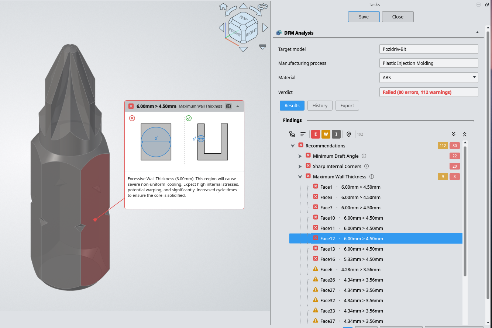
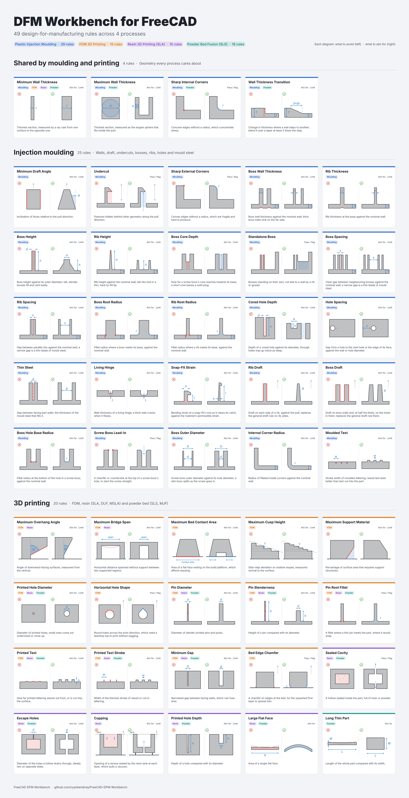
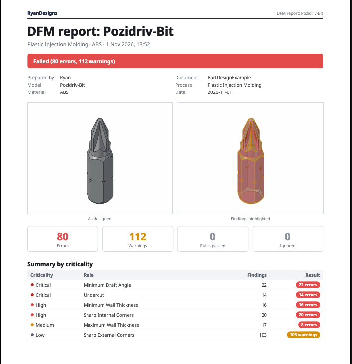
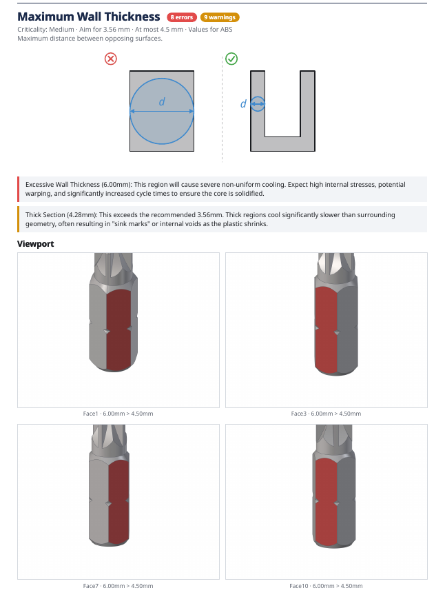
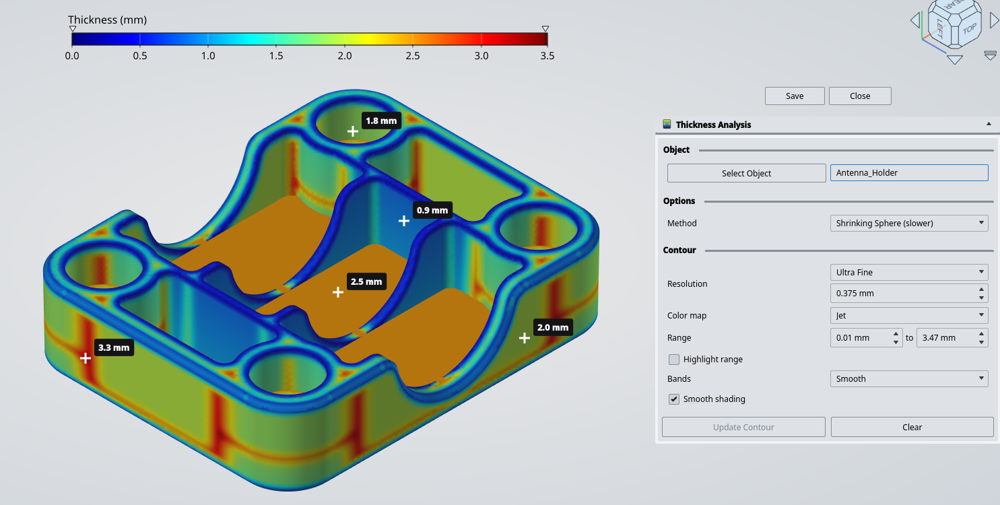
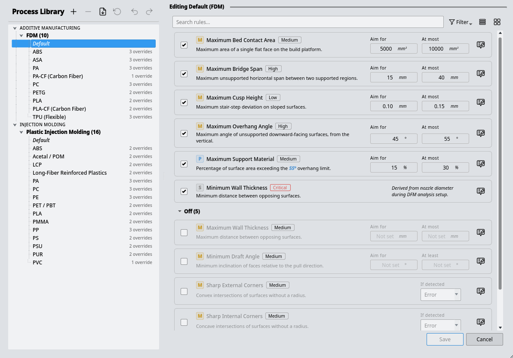
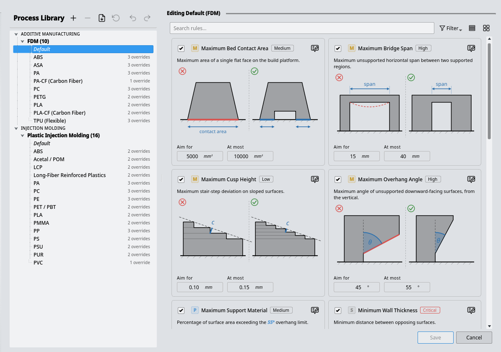
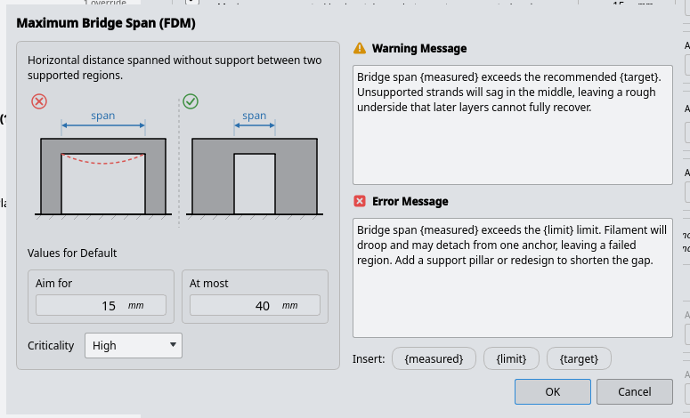

# DFM Workbench

A FreeCAD workbench that analyses 3D models for Design for Manufacturing (DFM)
issues, helping designers catch problems before they reach the factory.

The philosophy of this project is to give more power to hobbyists and small businesses to have access to powerful DFM tools that not only critique, but teach as well.

Another key point is customisability. Every rule is 100% customisable. The Process Library is the main way you can do this, but for experts, you can tweak the parameters for the geometric analyzers in the DFM Preferences page.

## Features

### Manufacturing processes

| Process | Rules | What it checks |
|:--|:-:|:--|
| **Plastic injection molding** | 29 | Wall thickness, draft, undercuts, ribs, bosses, cored holes, thin mold steel, snap fits, living hinges, molded text |
| **FDM 3D printing** | 15 | Overhangs, bridges, support material, bed contact, layer stair-stepping, small holes and pins, narrow gaps, text, elephant's foot |
| **Resin 3D printing** (SLA, DLP, MSLA) | 15 | Sealed hollows, drain holes, suction cups, overhangs, bridges, deep holes, narrow gaps, pins, text, peel forces |
| **Powder bed fusion** (SLS, MJF) | 16 | Sealed hollows, escape holes, thick sections, wall transitions, warping, deep holes, narrow gaps, pins, text |

Each process comes with material presets (ABS, PC, PP, PLA, PETG, PA12, TPU and more) whose limits follow published design guides.

### 49 design rules

Every rule explains itself with a diagram of what to avoid and what to aim for, and every finding says why it matters and how to fix it.

  

- **Walls and corners:** minimum and maximum wall thickness, wall thickness transitions, sharp internal and external corners, internal corner radius
- **Molding:** draft angle, undercuts; rib thickness, height, spacing, draft and root radius; boss wall, height, core depth, spacing, draft, root radius, hole base radius, lead-in and outer diameter; standalone bosses; cored hole depth and spacing; thin mold steel; living hinges; snap-fit strain; molded text
- **3D printing:** overhang angle, bridge span, support material, bed contact area, cusp height; printed hole diameter, depth and teardrop shape; pin diameter, slenderness and root fillet; printed text depth and stroke; minimum gap; bed edge chamfer; sealed cavities, escape holes and cupping; large flat faces and long thin parts

Rules about bosses, ribs, holes, snap fits, hinges, text and hollows find those features with a built-in feature recognition engine. Rules relative to the wall measure the part's nominal wall for you, or use one you enter.

### Analysis and results

- Findings grouped by rule and highlighted on the model, with the measured value against its limits
- Analysis runs on all your CPU cores, with live progress and time remaining
- Switch material and see the new results instantly, without measuring again
- History: compare any two runs to see what regressed and what was fixed, with a trend chart
- Generate professional PDF reports
- Export to CSV

  
  

## Contours

Analyse wall thickness or draft angles of your parts, and create nice graphics.

Four contour tools color the whole model: **thickness**, **draft angle**, **undercut** (which way each face releases from the mold) and **curvature** (the tightest radius).

  

## Process Library

Edit each rule's limits, severity, criticality and messages, for the process as a whole or for each material. Add your own processes and materials, or import them from a file.

  
  

  

## Installation

Install directly from the **FreeCAD Addon Manager**.

| Version | Support |
|---------|---------|
| FreeCAD 1.1+ | Officially supported |
| FreeCAD 1.0 | Should work, not tested |
| FreeCAD 0.x | Not supported (requires PySide6) |

## Contributing

If you'd like to help out, here are some ways you might consider contributing:

- Creating bug reports
- Suggesting new features
- Submitting code to fix bugs or add new features
- Creating user documentation on FreeCAD Wiki
- Sharing DFM knowledge for any manufacturing process (through submitting an issue would be great!)
- Creating example models for manufacturing processes that can be bundled with the workbench
- Creating tutorials either through a website or a video
