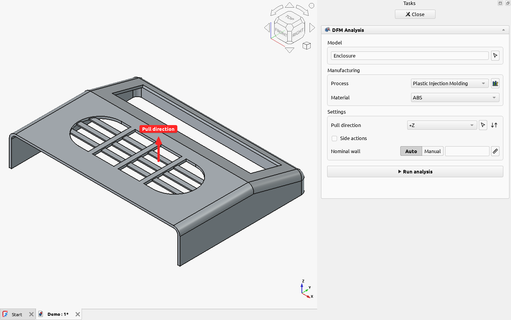

# Pull and print directions

Many rules only make sense in a direction.

- **Pull direction** (injection molding): the way the mold opens. Draft is measured against it,
  and a face that can't move out of the mold along it is an undercut.
- **Print direction** (FDM and resin printing): the way the part grows, up from the bed or build
  platform. Overhangs, bridges, supports, bed contact and resin cupping depend on it.

Powder bed fusion has none: the powder holds the part from every side.

## Setting a direction

The direction is shown as a red arrow on the model while you set up the analysis.

- Choose an **axis** (+X, −Y, +Z...) from the list.
- Or click the **arrow button** and pick in the 3D view: a **face** points the direction along the
  face's normal, a straight **edge** along the edge. While you pick, an arrow previews the face or
  edge under the cursor.
- **Flip** it with the ↓↑ button, or by clicking the arrow on the model.

For molding, the mold can also have **side actions**: slides and lifters that move another way.
See [injection molding](../guides/injection-molding.md#side-actions).

## Trying directions

A part prints or molds differently in each direction, and the right one isn't always obvious. Run
the analysis with each likely direction and compare the results, or use
[Draft Analysis and Undercut Analysis](../guides/contours-and-inspection.md) to see the whole part
at once for a direction before running all the rules.
