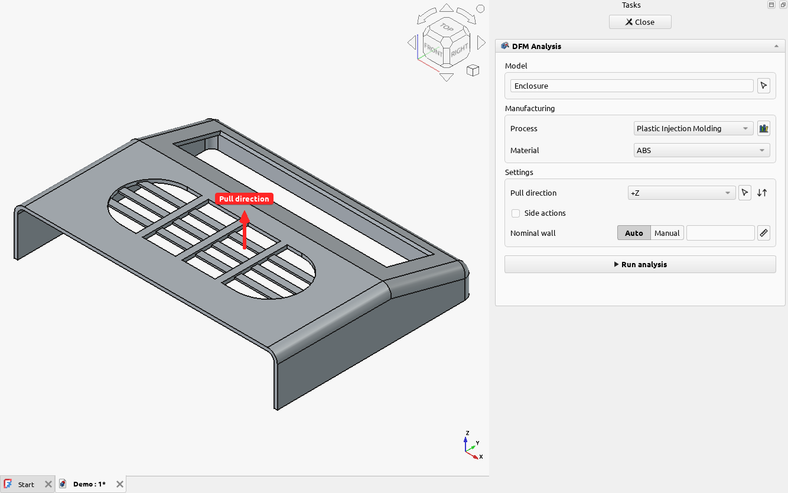
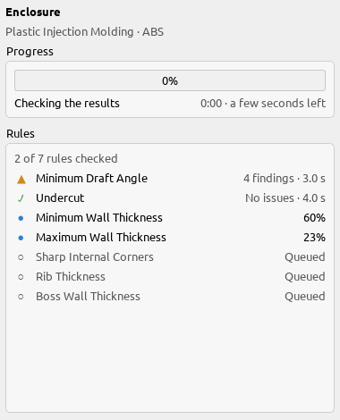
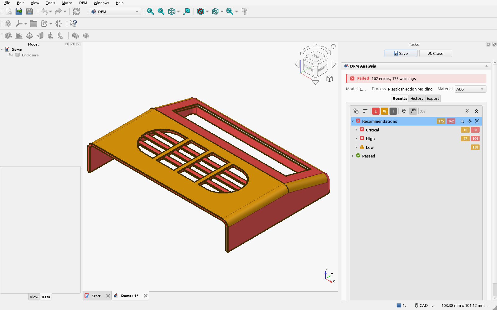

# Your first analysis

This walks through checking a part for injection molding: set up the analysis, run it, and see the
results. The same steps work for every process.

## 1. Open your part

Open the FreeCAD document with your part, or import a STEP file with **File → Import**. Switch to the
**DFM** workbench.

The workbench checks a single solid: a PartDesign Body, a Part feature or an imported solid.

## 2. Set up the analysis

Select your part in the tree or the 3D view, then click **DFM Analysis** on the toolbar.

The panel asks for:

- **Model**: the part to check. It's filled in with what you selected; the arrow button picks
  another part from the 3D view.
- **Process**: how the part will be made. The button beside it opens the
  [Process Library](../guides/process-library.md).
- **Material**: which material's values to check against. You can switch material after the
  analysis without measuring again.
- **Settings**: what this process needs to know. For injection molding that is the
  **pull direction**, the direction the mold opens, shown as a red arrow on the model.
  [Directions](../concepts/directions.md) explains how to set it.

Each process asks for different settings: the [process pages](../reference/processes/index.md)
list them.

## 3. Run it

Click **Run analysis**. The progress panel shows each rule as it is checked, and roughly how long is
left.

The analysis uses several processor cores for large parts. **Abort** stops it and takes you back
to the setup, with your settings as you left them.

## 4. See the results

When it finishes, the results panel opens and the problems are colored on the model: red for
errors, orange for warnings.

Next: [reading the results](reading-results.md).
