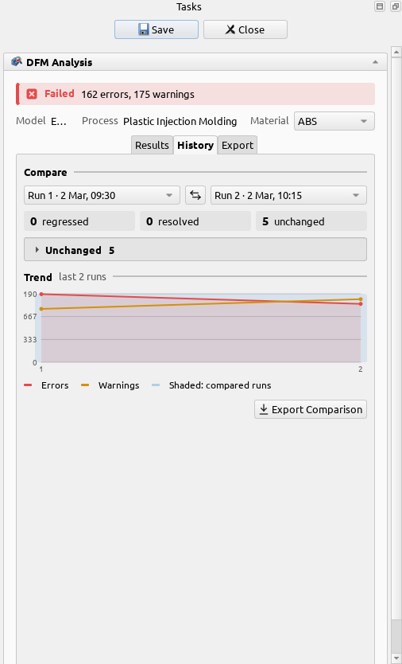

# Fixing a finding

The workbench is made for a loop: find a problem, change the model, check again, and see that it's
gone.

1. **Read the finding.** Select it and open its message from the info card in the 3D view. The
   message says why the problem matters and what to do about it, such as adding draft, coring out a thick boss or adding a fillet. Each
   rule's page in the [reference](../reference/rules/index.md) explains the rule with a diagram.
2. **Save the results** with **Save**, so this run is in the history.
3. **Change the model** in FreeCAD as usual.
4. **Run the analysis again** with **DFM Analysis**, with the same process and settings.
5. **Compare.** The **History** tab compares any two saved runs: what was fixed, what is new, and
   the trend of errors and warnings over all your runs.

## When a value is wrong for you

Sometimes the part is fine and the value is wrong for your case: your molder can hold a thinner
wall, or your printer bridges further. Change the value in the
[Process Library](../guides/process-library.md), for the whole process or for one material, and
run again. Every value says [where it comes from](../citations/index.md), so you can judge how
far to trust it.
