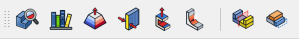

# Install

The DFM Workbench is a FreeCAD addon. Install it from FreeCAD's **Addon Manager**:

1. In FreeCAD, open **Tools → Addon manager**.
2. Search for **DFM** and install it.
3. The workbench needs a few Python packages: `cadquery-ocp`, `gmsh`, `scipy` and `numpy`.
   Install them when the Addon Manager offers to.
4. Restart FreeCAD, then choose **DFM** in the workbench list.

## Which FreeCAD

| FreeCAD | Support |
| :-- | :-- |
| 1.1 and later | Officially supported |
| 1.0 | Should work, not tested |
| 0.x | Not supported (the workbench needs PySide6) |

## What you get

The **DFM Analysis** toolbar and the **DFM** menu hold every tool:

| Tool | What it does |
| :-- | :-- |
| DFM Analysis | Check a part against a process and material, and see the findings |
| Process Library | Edit processes, materials, rule values and messages |
| Draft Analysis | Color the model by draft angle |
| Thickness Analysis | Color the model by wall thickness |
| Undercut Analysis | Color the model by the direction each face releases from the mold |
| Curvature Analysis | Color the model by its tightest radius |
| Symmetry Check | See whether a part is symmetric about a plane or axis, and what isn't |
| Compare Bodies | See what changed between two bodies, and where |

The workbench's settings are under **Edit → Preferences → DFM**.

Next: [your first analysis](first-analysis.md).
