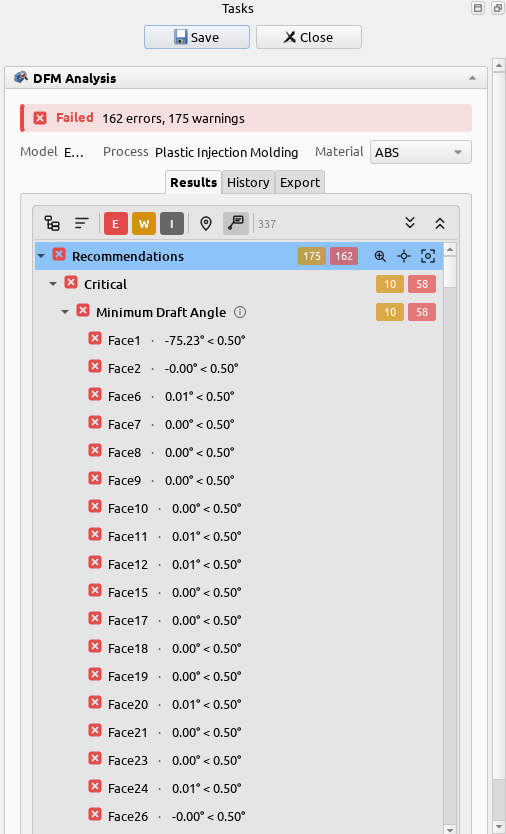
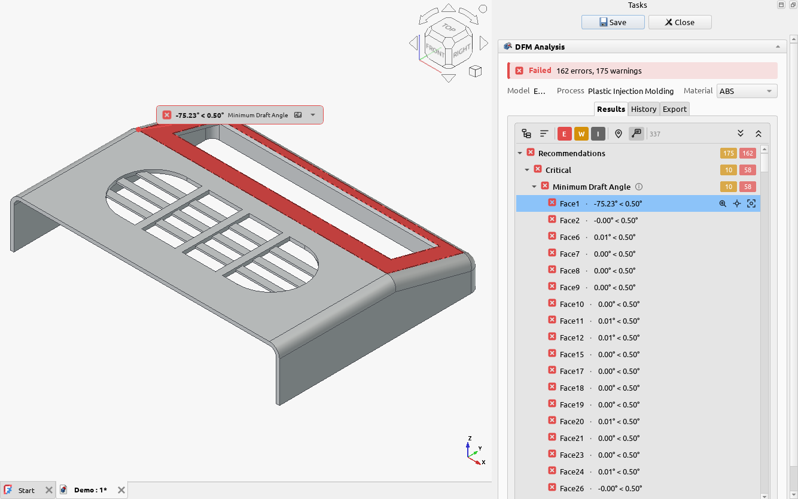

# Reading the results

## The summary

The top of the results panel says whether the part passed, and how many errors and warnings were
found. Under it are the model, the process and the **material**. Pick another material there to see
its results straight away: the model isn't measured again, only checked against the new values.

## The findings

Findings are grouped by the rule's [criticality](../concepts/criticality.md), Critical first, then
by rule. Each finding names the face or edge it is on and compares the measured value with the
limit it crossed, such as *0.00° < 0.50°* for a face with no draft where 0.5° is the least
allowed. Rules with no problems are listed under **Passed**.

The buttons above the list:

| Button | What it does |
| :-- | :-- |
| Grouping | Group by criticality and rule, by rule only, by face or edge, or not at all |
| Sorting | Worst first, by face or edge number, by rule name, or by how far past its limit |
| **E**, **W**, **I** | Show or hide errors, warnings and ignored findings |
| Markers | Show or hide markers on the model at every finding |
| Info card | Show or hide the card in the 3D view that points at the selected finding |

The ⓘ next to a rule's name shows its diagram and values.

## Looking at a finding

Click a finding to highlight its faces and turn the camera to them. The info card in the 3D view
names the rule and the measurement; its arrow opens the finding's message: what's wrong, why it
matters and how to fix it.

The buttons on the selected row, and its right-click menu, move the camera:

- **Zoom to** (`Z`), **Face it** (`F`) and **Zoom and face** (`Shift+F`) for the finding,
- **Whole model** (`Home`) and the standard views for the part.

Double-click a finding to zoom to it. **Copy Details** in the right-click menu copies its message.

## Ignoring findings

Some findings don't apply to your part: an edge on the parting line, a face that is meant to be
sharp. Right-click a finding and choose **Ignore**, or **Ignore All** on a rule. Ignored findings
are hidden unless **I** is on, and they don't count towards the result. **Restore** brings them
back.

## Keeping the results

Click **Save** to keep the results in your FreeCAD document, as a **DFM Results** object under the
part. Saving also adds the run to the **History** tab, so you can
[compare it with later runs](fixing-a-finding.md).
