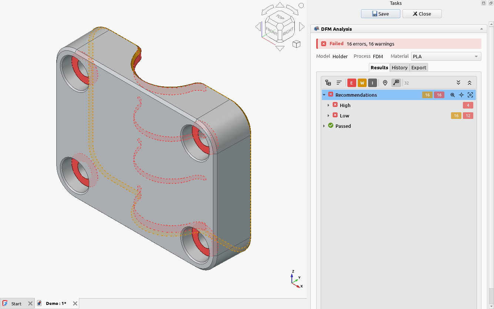
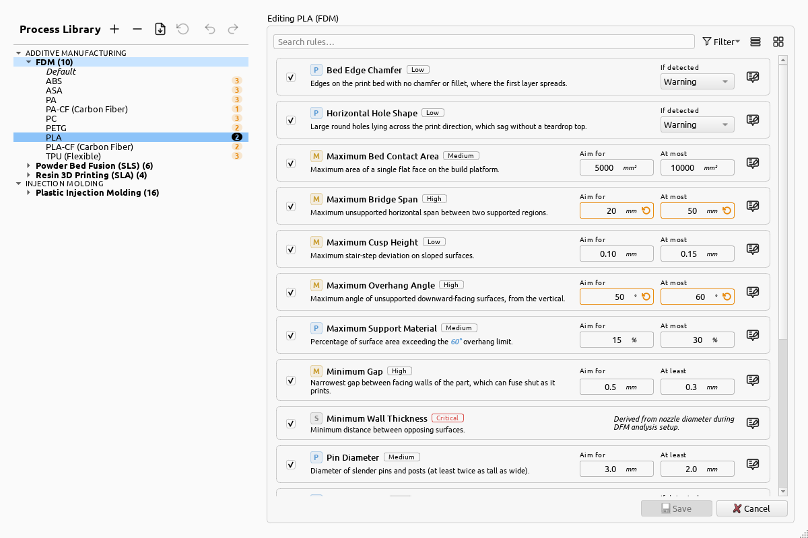

# 3D printing

The workbench has a process for each of the three common kinds of 3D printing. Each checks what goes
wrong in that kind of printer, and each asks for slightly different settings.

| Process | What it asks for |
| :-- | :-- |
| [FDM](../reference/processes/fdm-3d-printing.md) (filament) | Print direction, nozzle diameter, layer height |
| [Resin](../reference/processes/resin-3d-printing.md) (SLA, DLP, MSLA) | Print direction |
| [Powder bed fusion](../reference/processes/powder-bed-fusion.md) (SLS, MJF) | Nothing: the powder holds the part up on every side |

## Print direction

The **print direction** is the way the part grows on the printer: up, away from the bed or build
platform. Overhangs, bridges, supports, bed contact and resin cupping all depend on it, so set it as
you will print the part. It's set like the molding pull direction: see
[directions](../concepts/directions.md).

## FDM

FDM also asks for the **nozzle diameter** and **layer height** you will print with. The thinnest
wall and the thinnest printable text are worked out from the nozzle diameter, and the layer height
decides how visible the stair-stepping on shallow slopes is.

Each filament has its own values for overhangs, bridges and bed contact, since they cool and warp
differently. Pick your filament as the material, or [make your own](process-library.md).

## Resin

Resin printers peel each layer off the film of a resin tank. Besides overhangs and bridges, the
resin process checks for **sealed hollows** that trap liquid resin, **drain holes** too small to
empty them, and **cups**: recesses that seal against the tank and pull like a suction cup at every
peel.

## Powder bed fusion

The unfused powder supports the part, so there is nothing to set up and no overhang rules. Instead
the process checks for **sealed hollows** that keep their powder, **escape holes** to get it out,
thick sections and long, flat or uneven parts that warp as they cool.
