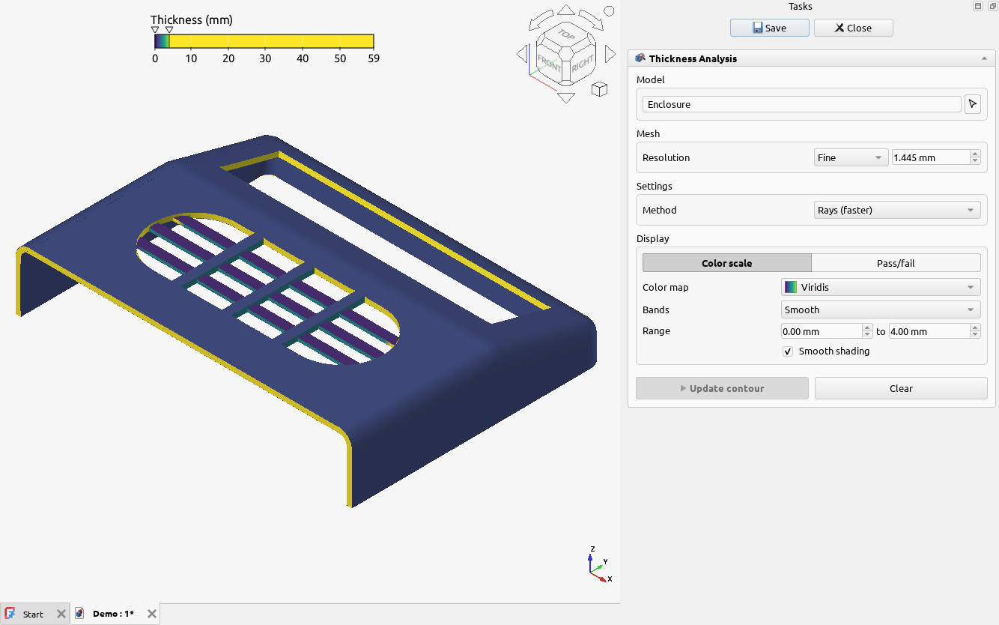
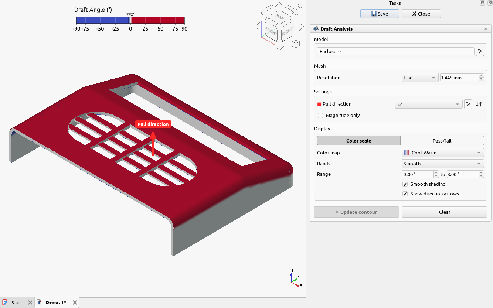
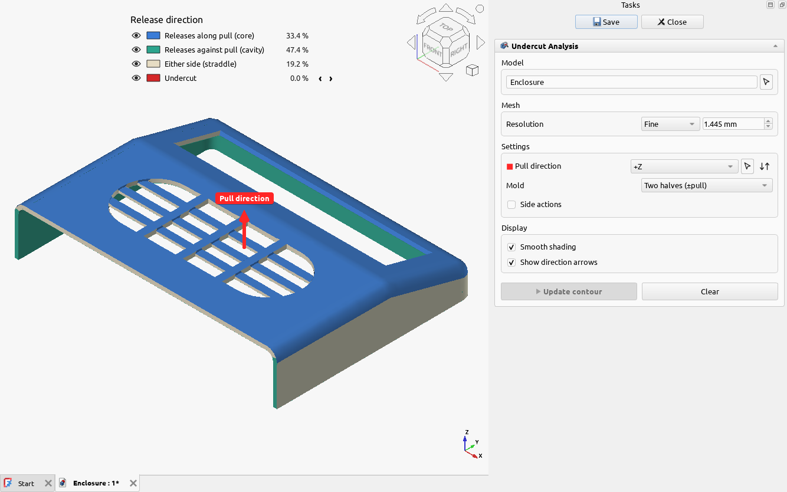
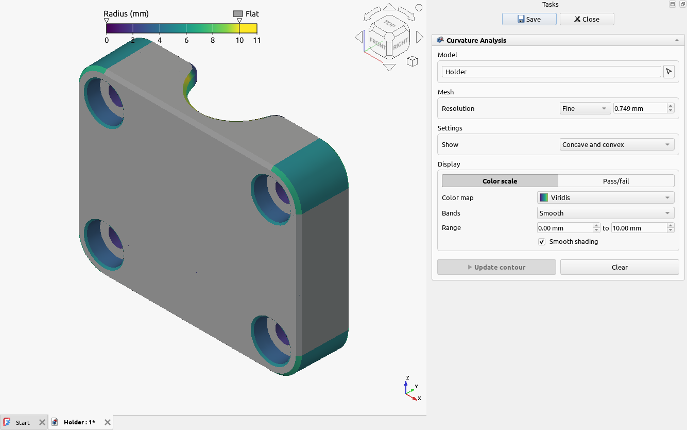
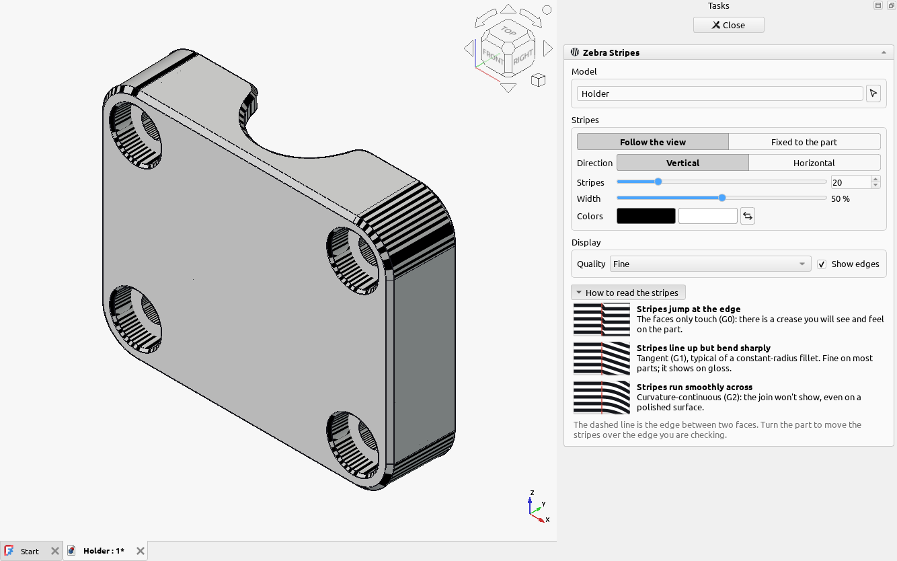
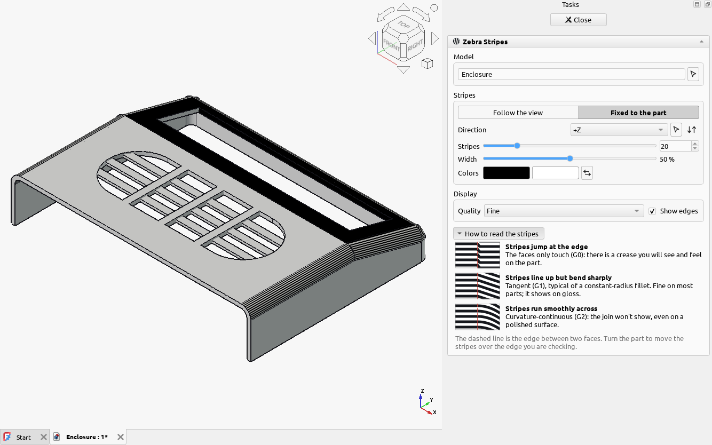
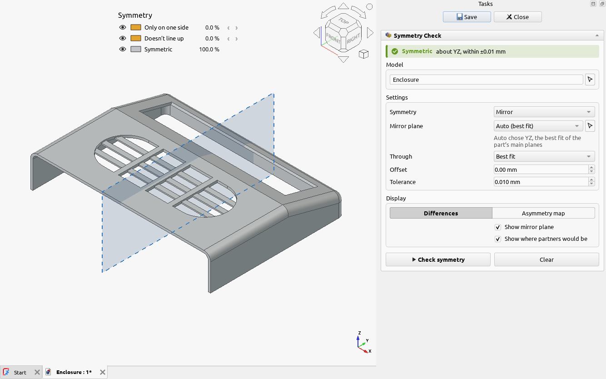
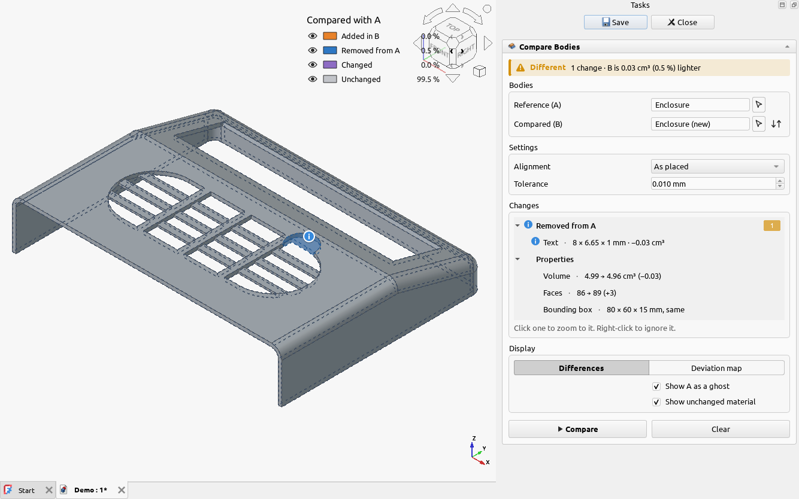

# Contours and inspection

These tools look at the whole part at once, rather than rule by rule. They need no process or
material, and they make good pictures for a design review.

## Contours

Each contour tool meshes the part evenly and colors it by one measurement. Pick the part, set what
the tool asks for, and click **Update contour**. **Save** keeps the contour in the document.

The **Display** settings are shared by all four: a **Color scale** or a **Pass/fail** view, the color
map, smooth or banded colors, and the range of values the colors cover. Set the range by hand to
look closely at the values that matter.

### Thickness Analysis

Colors the part by its wall thickness: thin walls at one end of the scale, thick ones at the other.

### Draft Analysis

Colors each face by its angle to the pull direction. See
[injection molding](injection-molding.md#draft-and-undercuts-at-a-glance).

### Undercut Analysis

Colors each face by the way it releases from the mold, with side actions if you add them.

### Curvature Analysis

Colors the part by its tightest radius of curvature: small fillets and sharp bends stand out. Flat
faces are gray.

## Zebra Stripes

Draws black and white stripes on the part, like the reflection of a row of strip lights on a glossy
surface. Where two faces meet, the way the stripes cross the edge shows how smoothly they join:

| The stripes at the edge | The join | On the finished part |
| --- | --- | --- |
| Jump sideways | The faces only touch (G0) | A crease you can see and feel |
| Line up, but bend sharply | Tangent (G1), as a constant-radius fillet gives | Fine on most parts; shows on gloss |
| Run smoothly across | Curvature-continuous (G2) | The join doesn't show |

This matters most on cosmetic faces of molded parts: a polished mold copies every reflection
defect onto every part. Zebra Stripes is also a quick check of STEP files from other systems, which
often carry small kinks between surface patches.

Open it with the part selected, or select some faces first to stripe only those. The stripes show at
once, and every setting applies straight away:

- **Follow the view** (the default): the stripes slide over the part as you turn it, as a reflection
  does. Turn the part slowly and watch the edge you are checking: a stripe that wobbles or breaks
  there shows a defect. Choose **Vertical** or **Horizontal** stripes.
- **Fixed to the part**: the stripes stay put as you turn the part. Each stripe follows a constant
  angle to a direction you choose (an axis, or a picked face or edge), so two pictures of the same
  part compare directly. Use the pull direction to see the faces around the parting line.
- **Stripes** and **Width** set how many stripes there are and how wide the dark ones are. More
  stripes show smaller changes in the surface. **Colors** sets the two colors.
- **Quality** sets how finely the part is meshed for the stripes. Use **Very fine** for a close look
  at a small fillet; it takes longer on a big part.

The stripes show only while the panel is open, and **Close** clears them. They don't change the part
or any analysis result.

## Symmetry Check

Checks whether a part is symmetric about a plane (a mirror) or an axis, and shows what isn't: faces
only on one side, and faces that don't line up with their partner. With **Auto**, it finds the best
plane for you.

## Compare Bodies

Compares two bodies, such as two versions of a part, and shows what was added, removed or changed,
and where. Each change is named ("Hole Ø8 → Ø10", "Text 8 × 6.65 × 1 mm") with its effect on the
volume.

