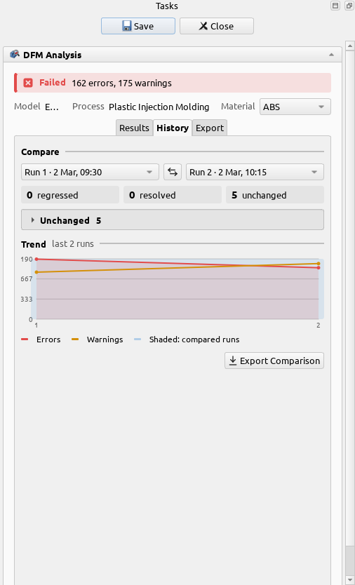
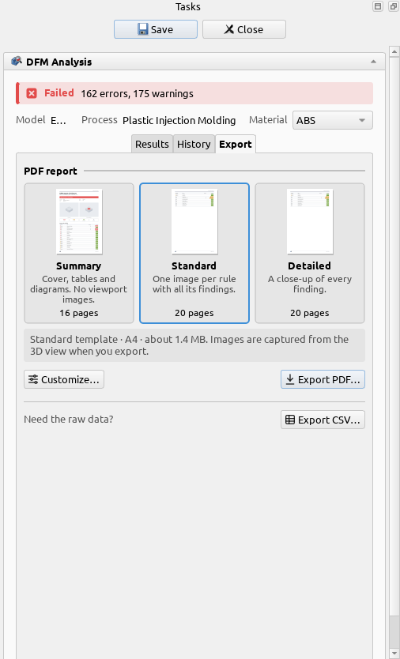
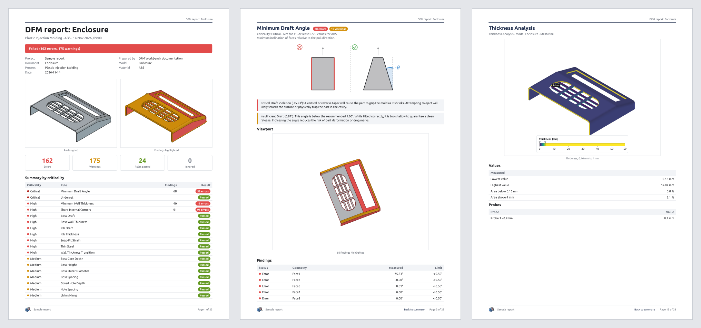

# History and reports

## History

Every time you **Save** results, the run is added to the part's history. The **History** tab of the
results panel compares any two runs: which findings were fixed, which are new, and which rules got
better or worse. The chart shows the errors and warnings of every run, with the two you are
comparing shaded.

Saved results also stay in your FreeCAD document, as a **DFM Results** object under the part, so
they are there when you open the file again.

## Reports and CSV

The **Export** tab writes the results to a file.

- **PDF report**: pick a preset, such as a short summary or one page per rule with an image of its
  findings, and export. **Customize…** opens the report dialog, where you choose the template,
  page size, images and what to include, with a live preview. Images are taken from the 3D view as
  the report is written. Defaults for new reports are in **Edit → Preferences → DFM → Reports**.
- **CSV**: the findings as a table, for a spreadsheet or your own tools.

### Adding contours and checks to a report

Anything you have saved in the document from the
[contour and inspection tools](contours-and-inspection.md) can go into the PDF report: a
Thickness, Draft, Undercut or Curvature Analysis, Zebra Stripes, a Symmetry Check or a comparison
from Compare Bodies. Tick it under **Analyses and checks** in the report dialog. Each one gets a page
of its own, listed on the cover:

- a contour: its picture with its legend, as in the 3D view, any probes you placed (also listed in
  a table), and its lowest and highest values;
- Zebra Stripes: the stripes with the settings you saved, and how to read them;
- a Symmetry Check or a comparison: its verdict, its picture with its key, and a table of the
  differences. It is checked again as the report is written, so it shows the part as it is now; if
  the part has changed since you saved it, the report says so.

### Finding your way around a report

The PDF has bookmarks for the summary, each rule, the passed rules, each added analysis or check and
the appendices; most PDF readers show them in a side panel. On the cover, each row of the summary
leads to its rule, and the error, warning and passed counts lead to the first rule of that kind.
"…listed in the appendix" leads there, and **Back to summary**, at the foot of every page, leads
back.

## A sample report

This report was written by **Export PDF report**, with the default report options, from an
analysis of one of the parts shown in these guides, with a saved Thickness Analysis (and a probe on
its thinnest wall), Symmetry Check and Zebra Stripes added. It is made again whenever the workbench
changes, so it always shows what the current version writes.

[Open the sample report (PDF)](../assets/reports/sample-dfm-report.pdf){ .md-button }
