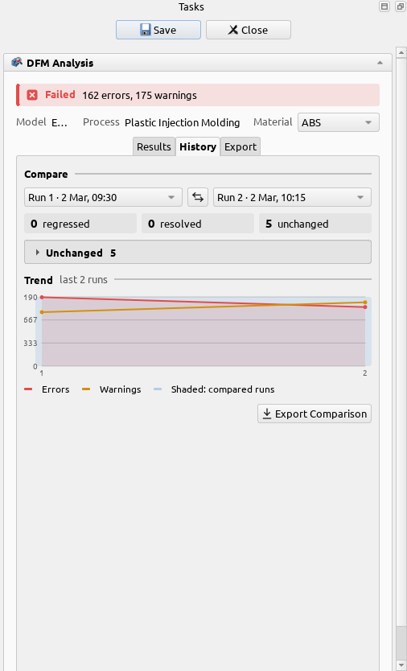
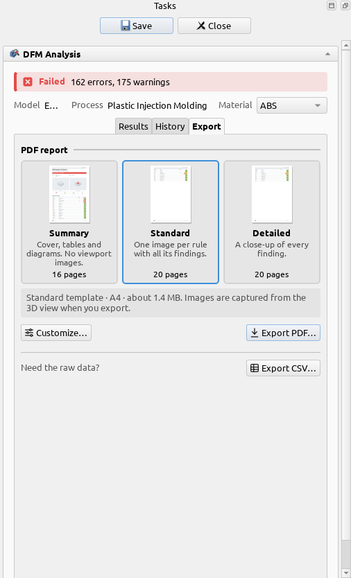

# History and reports

## History

Every time you **Save** results, the run is added to the part's history. The **History** tab of the
results panel compares any two runs: which findings were fixed, which are new, and which rules got
better or worse. The chart shows the errors and warnings of every run, with the two you are
comparing shaded.

Saved results also stay in your FreeCAD document, as a **DFM Results** object under the part, so
they are there when you open the file again.

## Reports and CSV

The **Export** tab writes the results to a file.

- **PDF report**: pick a preset, such as a short summary or one page per rule with an image of its
  findings, and export. **Customize…** opens the report dialog, where you choose the template,
  page size, images and what to include, with a live preview. Images are taken from the 3D view as
  the report is written. Defaults for new reports are in **Edit → Preferences → DFM → Reports**.
- **CSV**: the findings as a table, for a spreadsheet or your own tools.
