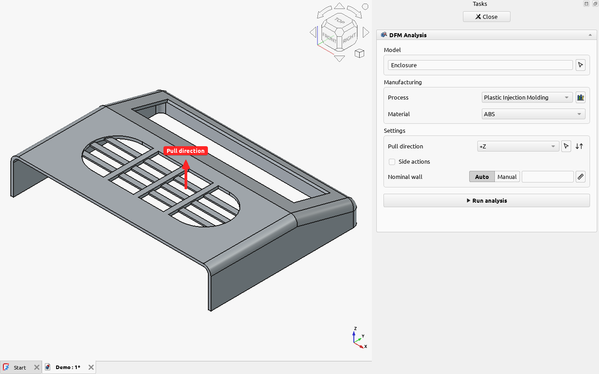
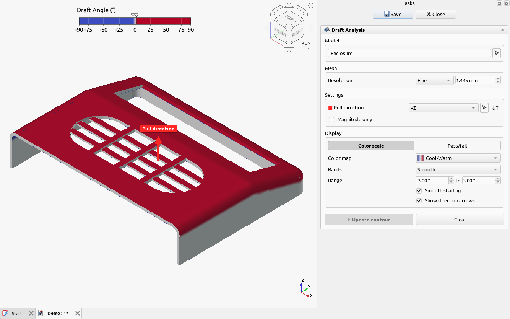
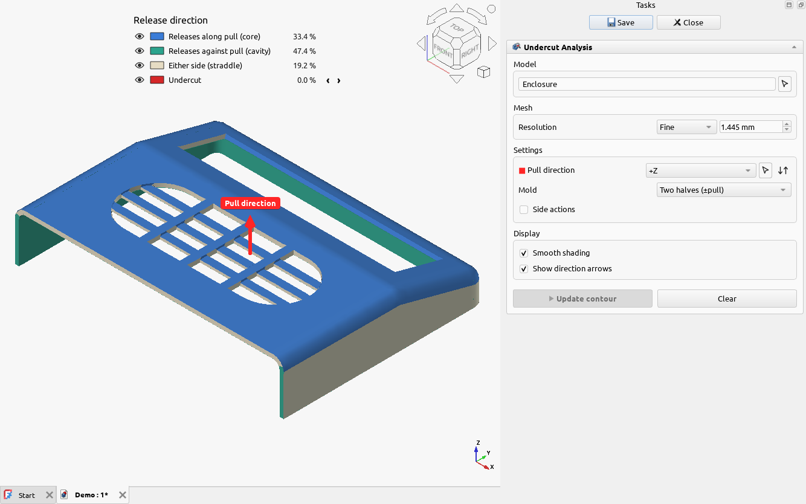

# Injection molding

The [Plastic Injection Molding](../reference/processes/plastic-injection-molding.md) process checks
the things that decide whether a part molds well and cheaply: wall thickness, draft, undercuts,
ribs, bosses, holes, snap fits, living hinges and molded text.

## Setting up

### Pull direction

The direction the mold opens, shown as a red arrow on the model. Draft and undercuts are measured
against it, so set it before anything else. Choose an axis from the list, or click the arrow button
and pick a face (its normal) or a straight edge in the 3D view. The ↓↑ button, or a click on the
arrow in the 3D view, flips it. [Directions](../concepts/directions.md) has more.

### Side actions

Tick **Side actions** if the mold has slides, lifters or pickouts, and add the direction each one
moves in. Faces a side action forms are then judged along its own direction: they count as drafted
and released when they draw cleanly that way, instead of being flagged as undercuts.

### Nominal wall

Many molding rules compare a feature with the part's main wall: a rib or a boss's wall should be
thinner than it, or the plastic sinks on the face behind. **Auto** measures the nominal wall for you; **Manual** lets you type
it. See [nominal wall](../concepts/nominal-wall.md).

## Draft and undercuts at a glance

Before the full analysis, two contour tools show the whole part at once.

**Draft Analysis** colors each face by its draft to the pull direction. Faces near zero (white) are
the ones that drag on the mold (the pale middle of the scale); the sign says which half of the
mold forms them.

**Undercut Analysis** colors each face by the way it leaves the mold: with the core, with the cavity,
either, or not at all (an undercut). Click a category in the legend to hide it, or to step through
its regions on the model.

## Features

Rules about ribs, bosses, holes, snap fits, living hinges and text need to know where those
features are. The workbench finds them itself: see [feature recognition](../concepts/feature-recognition.md).

## The rules

Every rule this process checks, with its values for each material, is on the
[process page](../reference/processes/plastic-injection-molding.md).
