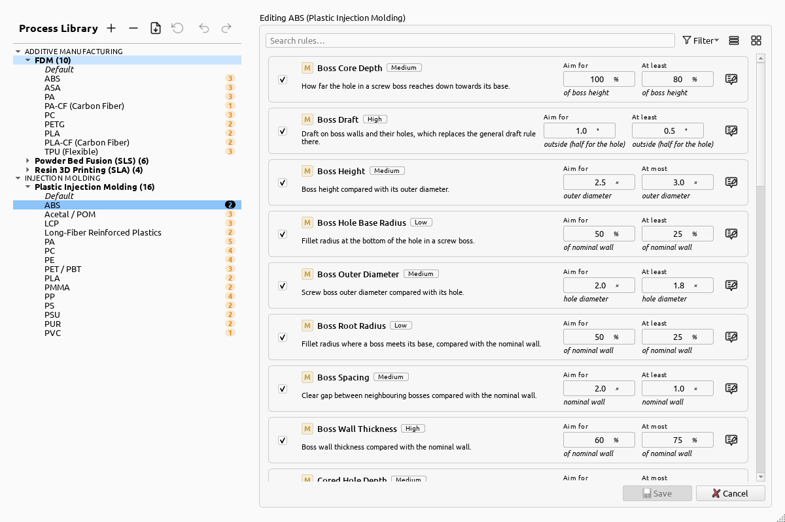
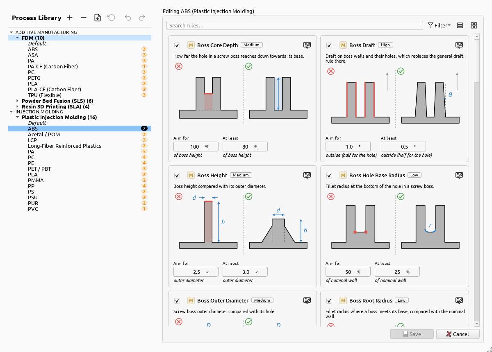
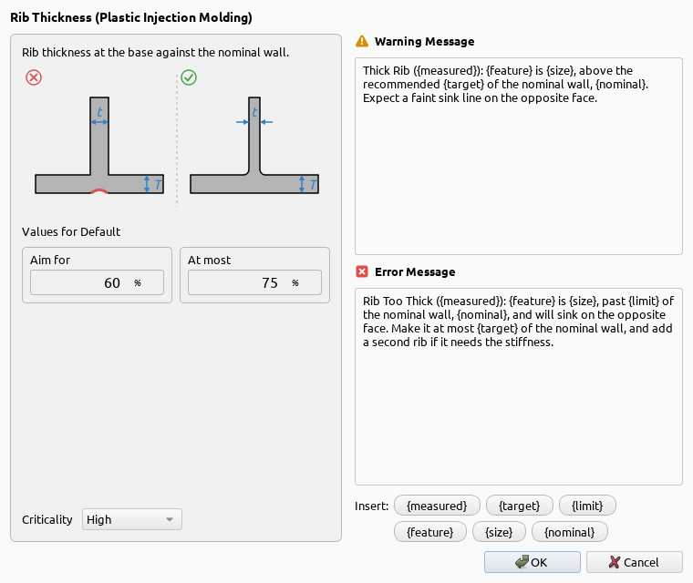

# Process Library

Every value the workbench checks against lives in the **Process Library**: open it from the toolbar,
or with the button next to **Process** in the analysis setup.

## Processes and materials

On the left are the processes, grouped by kind, and under each its materials. Every process has a
**Default** material that holds a value for every rule. The other materials only change the values
that differ for them; the number beside a material says how many rules differ from Default.

The buttons above the list:

- **+** adds a process, or a material to the selected process.
- **−** deletes the selected process or material.
- The import button adds a process from a `.yaml` file, such as one a colleague shared.
- The restore button puts a built-in process back the way it shipped.
- Undo and redo step through your edits.

## Rules

On the right are the selected material's rules, one card each:

- The **checkbox** turns the rule on or off for the process.
- The letter says where the value is set. **M**: per material. **P**: once for the whole process.
  **S**: worked out from the analysis setup, such as FDM's thinnest wall from the nozzle diameter.
- The [criticality](../concepts/criticality.md) chip says how much the rule matters for the process.
- The fields are the rule's values: [*Aim for* and its limit](../concepts/aim-for-and-limits.md). A
  material's value that differs from Default can be reset to it with the button that appears beside
  it.
- The button on the right edits the rule's messages and criticality.

**Search** and **Filter** narrow the list: for example to the rules that differ from the Default
material. The two buttons beside them switch between this list and a grid, which shows each rule's
diagram:

Click **Save** to keep your changes. They are stored in your FreeCAD user folder and take priority
over the built-in processes, which updates of the workbench don't overwrite.

## Messages

Every rule has a warning message and an error message, shown with each finding. Edit them, and the
rule's criticality, with the button on the right of its card:

The words in `{braces}` are filled in for each finding: the measured value, the rule's values, the
feature's name and size. Click one under the messages to insert it. Each rule's
[reference page](../reference/rules/index.md) lists its placeholders.
