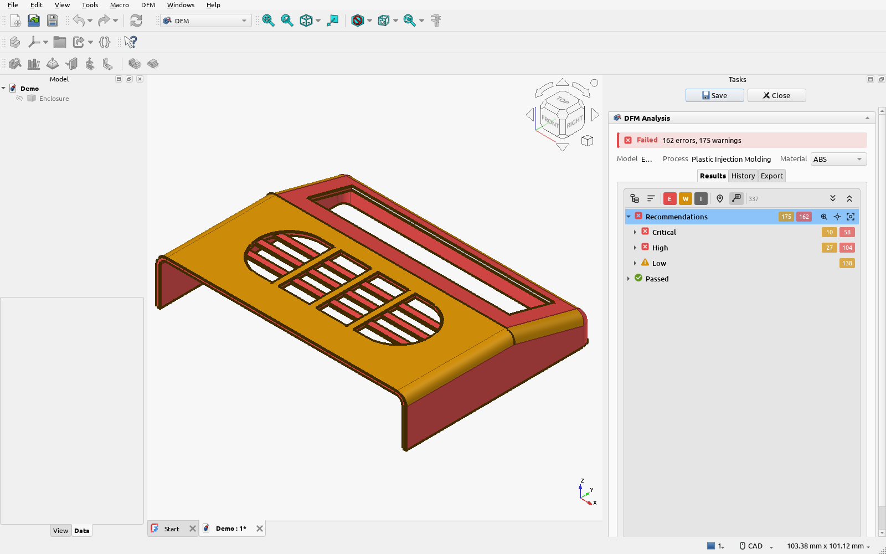

# DFM Workbench

A [FreeCAD](https://www.freecad.org) workbench that checks your 3D models for design for manufacturing
(DFM) problems, so you catch them before they reach the factory or the printer.

It's made for hobbyists and small businesses. It doesn't only flag problems: every finding says why
it matters and how to fix it, and every rule explains itself with a diagram of what to avoid and
what to aim for.

-   **Plastic injection molding**

    Wall thickness, draft, undercuts, ribs, bosses, holes, snap fits, living hinges and molded text.

    [See the process](reference/processes/plastic-injection-molding.md)

-   **FDM 3D printing**

    Overhangs, bridges, supports, bed contact, small holes and pins, gaps and elephant's foot.

    [See the process](reference/processes/fdm-3d-printing.md)

-   **Resin 3D printing**

    Sealed hollows, drain holes, suction cups, overhangs, bridges, thin pins and fine detail.

    [See the process](reference/processes/resin-3d-printing.md)

-   **Powder bed fusion**

    Sealed hollows, escape holes, thick sections, wall transitions, long thin parts and warping.

    [See the process](reference/processes/powder-bed-fusion.md)

## What it does

- **Checks your part** against the rules of a manufacturing process and material, and shows each
  finding on the model with the measured value next to its limit.
- **Lets you change everything.** Every rule's values, criticality and messages can be edited in the
  Process Library, and you can add your own processes and materials.
- **Colors the whole model** by wall thickness, draft angle, undercut direction or curvature.
- **Tracks your progress**: compare any two runs to see what was fixed and what regressed, and export
  a PDF report or a CSV file.

## Where to start

- New to the workbench? [Install it](getting-started/install.md), then run
  [your first analysis](getting-started/first-analysis.md).
- Want to know what a rule checks? Browse [the rules](reference/rules/index.md).
- Wondering where a number comes from? Every value has its source on its rule's page, and
  [the citations](citations/index.md) show what is sourced and what isn't yet. See
  [why you can trust it](why-trust-it.md).

!!! info "Always up to date"

    This site is built from the workbench's latest version. The reference pages and pictures are
    generated from its code, so they change when the workbench does.
