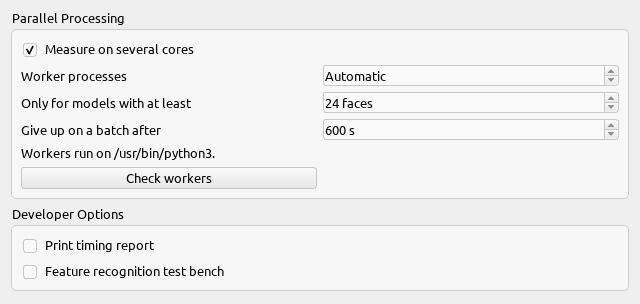
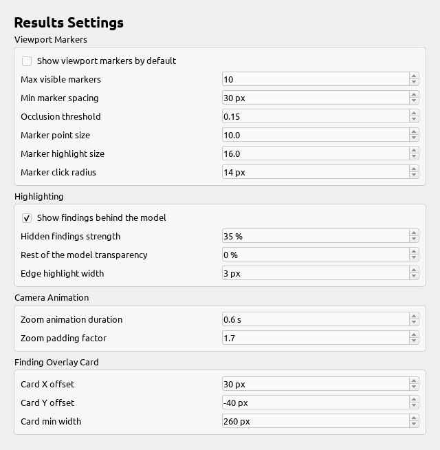
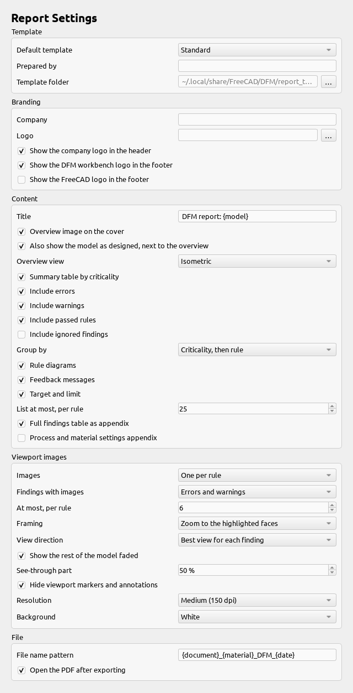
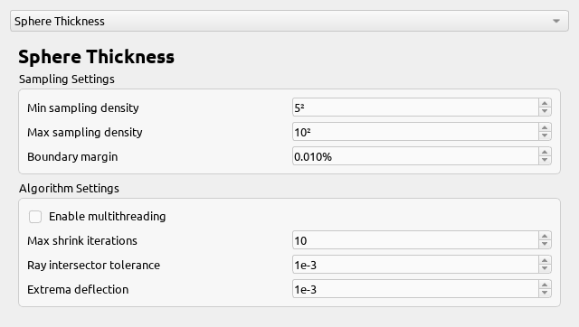
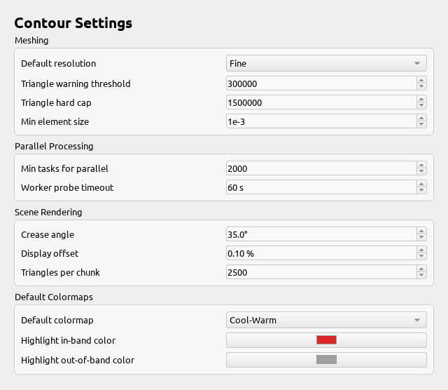
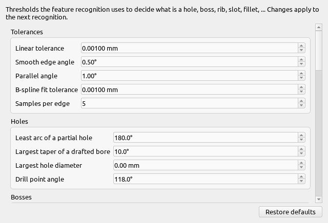

<!-- Generated by docs/build.py from docs/_pipeline/shots/panels.py, freecad/DFM/gui/preferences.py and the other preference pages. Do not edit this file: change its sources and run `pixi run docs`. -->

# Preferences

The workbench's settings are under **Edit → Preferences → DFM**. Most people never need to change them: the values each rule checks against are set in the [Process Library](../guides/process-library.md), not here.

## General

Parallel processing (how many processor cores an analysis may use, and from what model size it bothers), and developer options.

## Results

How findings are shown in the 3D view and in the results panel.

## Reports

The defaults a new PDF report starts from: template, images and what to include.

## Analyzers

Expert settings for how each analyzer measures the model: ray counts, tolerances and angles. The defaults suit most parts.

## Contour

Defaults for the contour tools: color map, mesh resolution and legend.

## Feature Recognition

Every threshold the feature recognition engine uses to tell holes, bosses, ribs and the rest apart.

